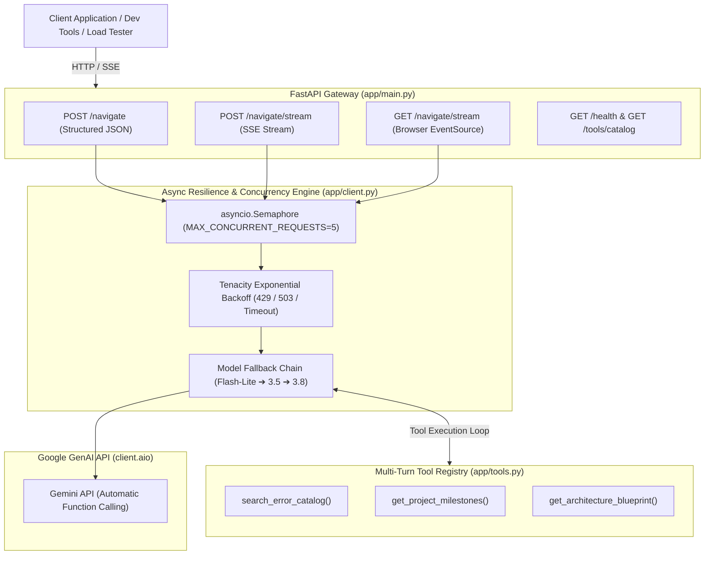

<div align="center">

# 🧭 Tutorial Hell Navigator

**An Eval-First AI Mentor & Retrieval Engine Transitioning CS Students from Passive Tutorial Copying to Independent Software Engineering**

[](https://www.python.org/)
[](https://fastapi.tiangolo.com)
[](https://docs.pydantic.dev/)
[](https://qdrant.tech/)
[](tests/)
[](eval/gold_set.json)
[](LICENSE)

[Architecture](#-system-architecture) •
[Features](#-core-features) •
[Quickstart](#-quickstart) •
[Docker](#-docker-deployment) •
[API Reference](#-api-reference) •
[Load Testing](#-concurrency-benchmarking) •
[Gold Set Eval](#-deterministic-80-question-benchmark) •
[Roadmap](#-phase-2-flagship-roadmap)

</div>

---

## 💡 The Problem: Why Tutorial Hell Navigator?

Computer science students and self-taught developers regularly get trapped in **"Tutorial Hell"**—passively copying lines of code from videos and guides without understanding architectural design decisions, Docker dependencies, or debugging failure trees. When confronted with an empty editor, missing environment headers, or a database connection deadlock, they freeze and abandon the project.

Generic AI assistants often exacerbate this paralysis by dumping monolithic blocks of untested code or offering empty platitudes like *"keep practicing"*.

| Dimension | Generic Chatbots (ChatGPT / Claude vanilla) | **Tutorial Hell Navigator (Eval-First RAG)** |
| :--- | :--- | :--- |
| **Response Format** | Unpredictable, unstructured prose text | **Strict Pydantic JSON schema** with explicit sequential steps |
| **Student Agency** | Monolithic code dumps (copy-paste crutch) | **Granular CLI commands + rationale + verification checks** |
| **Pitfall Protection** | Ignores subtle bugs and vulnerabilities | **Mandatory anti-patterns to avoid** in every action plan |
| **Error Diagnosis** | Hallucinates plausible-sounding fixes | **Deterministic tool calling** into a verified error resolution catalog |
| **Reliability** | Cascading `429` / `503` failures under load | **Tenacity backoff + model fallback chain + Semaphore concurrency cap** |
| **Evaluation** | Subjective vibes | **Deterministic 80-question gold benchmark** with strict pass/fail rubrics |

---

## 🏛️ System Architecture



---

## 📂 Repository Layout

```
tutorial-hell-navigator/
├── .github/
│   └── workflows/
│       └── ci.yml             # GitHub Actions CI workflow (Pytest + Gold Set validation)
├── app/
│   ├── __init__.py            # Package root & version metadata
│   ├── client.py              # Async Gemini client, retry backoff, model fallback, semaphore, RAG prompt
│   ├── ingestion.py           # Document ingestion, PyMuPDF extraction, token-aware chunking
│   ├── main.py                # FastAPI endpoints (/navigate, /navigate/stream, /health, /telemetry)
│   ├── rag.py                 # Qdrant client, dense vector indexing, cosine similarity retrieval
│   ├── schemas.py             # Strict Pydantic v2 JSON models (citations, refusal flags, trajectories)
│   ├── telemetry.py           # JSONL query trajectory logger & retrieval for error taxonomy analysis
│   └── tools.py               # Tool registry: error catalog, 7-day milestones, blueprints
├── benchmarks/
│   ├── __init__.py            # Benchmarking package
│   ├── chunk_eval.py          # Lexical hit-rate benchmark evaluating 256 vs 512 vs 1024 chunk sizes
│   └── load_test.py           # Concurrency stress tester measuring P50/P90/P95/P99 latency spikes
├── corpus/
│   ├── __init__.py            # Corpus package
│   ├── raw/                   # Raw technical manuals (FastAPI, Docker, CS Roadmap PDF/MD)
│   └── processed/             # Tokenized overlapping chunk sets (256, 512, 1024 tokens)
├── data/                      # Local Qdrant vector database persistence
├── logs/                      # Runtime telemetry logs (query_trajectories.jsonl)
├── eval/
│   ├── __init__.py            # Evaluation package
│   ├── flagship_spec.md       # Engineering RFC, rubrics, and scoring matrix
│   ├── gold_set.json          # Deterministic 80-question gold evaluation benchmark
│   └── run_eval.py            # Automated benchmark evaluation harness & rubric grader
├── tests/
│   ├── __init__.py            # Test package
│   ├── test_engine.py         # 14 unit & integration tests (schemas, tools, resilience, API)
│   ├── test_ingestion.py      # 7 tests verifying PDF extraction, text cleaning & chunk evaluation
│   └── test_rag.py            # 8 tests verifying Qdrant retrieval, citations, refusal path & telemetry
├── .dockerignore              # Excluded build artifacts for Docker
├── .env.example               # Clean environment variables configuration template
├── .gitignore                 # Secure git exclusions (.env, .venv, pycache, local db)
├── docker-compose.yml         # One-command orchestration
├── Dockerfile                 # Multi-stage production container build
├── LICENSE                    # MIT License
├── pyproject.toml             # Project metadata and test configuration
├── README.md                  # Flagship documentation
└── requirements.txt           # Production dependencies
```

---

## ✨ Core Features

### 1. Strict Pydantic Schema Enforcement (`app/schemas.py`)
Guarantees the LLM returns deterministic, machine-readable JSON rather than conversational fluff:
- **`ActionableStep`**: Sequential `step_number` (`>=1`), descriptive `title`, exact `command` or code snippet, `explanation`, and `verification` check.
- **`NavigatorResponse`**: Technical `summary`, ordered `action_plan` (`min_length=1`), explicit `anti_patterns_to_avoid` (`min_length=1`), and optional `architecture_contract` / `key_takeaway`.

### 2. Multi-Turn Tool Calling (`app/tools.py`)
Allows the model to intelligently route student queries to verified deterministic tools:
- `search_error_catalog`: Matches runtime signatures (`psycopg2`, `CORS`, `ModuleNotFoundError`, Docker daemon locks, `JWT`, `SQLite`, Git conflicts, `TLE`, `EADDRINUSE`) to battle-tested root-cause fixes.
- `get_project_milestones`: Returns structured 7-day milestone roadmaps for FastAPI, Fullstack, RAG, and DSA.
- `get_architecture_blueprint`: Supplies standard directory trees and layer contracts to eliminate blank-editor paralysis.

### 3. Asynchronous Scaling & Concurrency Throttling (`app/client.py`)
- Built completely on **`asyncio`** and **`httpx`** (`client.aio` from `google-genai`), preventing the ASGI event loop from blocking during generation.
- **`asyncio.Semaphore`** caps concurrent in-flight outbound requests to prevent cascading `429 RESOURCE_EXHAUSTED` rate-limit errors.

### 4. Production Resilience & Model Fallback Chain
- **Exponential Backoff:** Configured via `tenacity` (`min=2s`, `max=10s`, `attempts=3`) targeting transient server errors (`503`, `500`), network disconnects, and transient rate limits.
- **Dynamic Model Fallback:** Automatically cascades across candidate models (`gemini-flash-lite-latest` ➔ `gemini-3.5-flash-lite` ➔ `gemini-3.5-flash` ➔ `gemini-3.8-flash`) if any individual tier hits free-quota exhaustion.

### 5. Real-Time Token Streaming (SSE)
- Streams response tokens in real-time using **Server-Sent Events** (`text/event-stream`).
- Exposes both `POST /navigate/stream` for programmatic clients and `GET /navigate/stream?query=...` for native browser `EventSource` connections.

### 6. Naive RAG Baseline with Qdrant (`app/rag.py`)
- Vectorizes 512-token documentation chunks using **`gemini-embedding-001`** (3072 dimensions).
- Persists and queries vectors via local **Qdrant** with Cosine similarity search, retrieving top-3 grounded passages.
- Injects structured context headers (`[CHUNK_ID: ...]`) directly into the generation prompt.

### 7. Strict Inline Citations & Out-of-Bounds Refusal
- Mandates exact `chunk_id` references attached to every claim in `ActionableStep.citations` and aggregated in `NavigatorResponse.cited_chunk_ids`.
- Prevents ungrounded hallucination: triggers `is_refusal=True` and a clear `refusal_reason` whenever similarity drops below the out-of-corpus threshold (0.40) or no verified technical documentation exists.

### 8. Query Trajectory Telemetry (`app/telemetry.py`)
- Logs every request, retrieved chunk scores, inline citations, latency (ms), and refusal triggers to `logs/query_trajectories.jsonl`.
- Exposes `GET /telemetry/trajectories` for runtime inspection and Day 47 failure taxonomy analysis.

---

## 🚀 Quickstart

### Prerequisites
- Python 3.10+ (tested on Python 3.12)
- A Google Gemini API key ([Get one free at Google AI Studio](https://aistudio.google.com/))

### 1. Clone & Set Up Virtual Environment

```bash
git clone https://github.com/<YOUR-USERNAME>/tutorial-hell-navigator.git
cd tutorial-hell-navigator

# Create and activate virtual environment
python -m venv .venv
# On Windows (PowerShell):
.\.venv\Scripts\Activate.ps1
# On macOS / Linux:
source .venv/bin/activate
```

### 2. Install Dependencies

```bash
pip install -r requirements.txt
```

### 3. Configure Environment Variables

Copy the example template to create your `.env` file:
```bash
cp .env.example .env
```

Edit `.env` with your API key:
```env
GEMINI_API_KEY="your-gemini-api-key-here"
GEMINI_MODEL="gemini-flash-lite-latest"
MAX_CONCURRENT_REQUESTS=5
```

### 4. Launch the FastAPI Application

```bash
uvicorn app.main:app --reload --port 8000
```

- 📖 **Interactive Swagger UI:** [http://localhost:8000/docs](http://localhost:8000/docs)
- 🩺 **Health Check Endpoint:** [http://localhost:8000/health](http://localhost:8000/health)

---

## 🐳 Docker Deployment

Run the complete multi-stage containerized application with Docker Compose:

```bash
# Build and run container in background
docker compose up -d --build

# Inspect container logs
docker compose logs -f

# Verify service health
curl http://localhost:8000/health

# Stop service
docker compose down
```

---

## 🔌 API Reference

### 1. Structured Navigation (`POST /navigate`)
Generates a strictly validated, non-fluff action plan.

**Request:**
```bash
curl -X POST "http://localhost:8000/navigate" \
     -H "Content-Type: application/json" \
     -d '{"query": "How do I fix a CORS error in FastAPI when calling from React?"}'
```

**Response (`200 OK`):**
```json
{
  "summary": "Fix CORS in FastAPI by mounting CORSMiddleware with allowed frontend origins before declaring routes.",
  "action_plan": [
    {
      "step_number": 1,
      "title": "Import CORSMiddleware",
      "command": "from fastapi.middleware.cors import CORSMiddleware",
      "explanation": "Provides middleware to inject Access-Control-Allow-Origin headers into HTTP responses.",
      "verification": null
    },
    {
      "step_number": 2,
      "title": "Mount Middleware to App Instance",
      "command": "app.add_middleware(CORSMiddleware, allow_origins=['http://localhost:3000'], allow_credentials=True, allow_methods=['*'], allow_headers=['*'])",
      "explanation": "Explicitly permits preflight OPTIONS and cross-origin requests from the React dev server.",
      "verification": "curl -I -X OPTIONS http://localhost:8000/ -H 'Origin: http://localhost:3000'"
    }
  ],
  "anti_patterns_to_avoid": [
    "Using allow_origins=['*'] when allow_credentials=True (browsers reject wildcard credentials).",
    "Adding CORS middleware after route definitions instead of during app initialization."
  ],
  "architecture_contract": null,
  "key_takeaway": "CORS is a browser security mechanism, not a backend error. The server must explicitly whitelist origins."
}
```

---

### 2. Real-Time Token Streaming (`POST` / `GET /navigate/stream`)
Streams tokens sequentially using standard Server-Sent Events (SSE).

**Request (cURL):**
```bash
curl -N -X POST "http://localhost:8000/navigate/stream" \
     -H "Content-Type: application/json" \
     -d '{"query": "I am getting psycopg2 error in Docker"}'
```

**Response (`text/event-stream`):**
```
data: {"text": "To"}

data: {"text": " fix the psycopg2"}

data: {"text": " error in Docker, install"}

data: {"text": " libpq-dev and gcc..."}

data: [DONE]
```

---

## ⚡ Concurrency Benchmarking

The repo includes a dedicated load-testing suite ([`benchmarks/load_test.py`](benchmarks/load_test.py)) built with `asyncio.gather`. It stresses the engine under concurrency and computes percentile latency spikes:

```bash
# Benchmark structured JSON generation with 5 requests at concurrency 3
python benchmarks/load_test.py -n 5 -c 3

# Benchmark real-time SSE token streaming
python benchmarks/load_test.py -n 5 -c 3 --stream
```

### Verified Benchmark Output Under Concurrency:
```
=================================================================
>> TUTORIAL HELL NAVIGATOR - LOAD & CONCURRENCY BENCHMARK
=================================================================
 Mode:             In-Process (ASGITransport)
 Target Endpoint:  /navigate/stream
 Mode Type:        Server-Sent Events (SSE)
 Total Requests:   3
 Max Concurrency:  2 (Semaphore capped)
 Query Payload:    'How do I fix a CORS error in FastAPI?...'
-----------------------------------------------------------------
>> BENCHMARK RESULTS
-----------------------------------------------------------------
 Execution Duration:    10.38 s
 Throughput:            0.29 req/s
 Success Rate:          3/3 (100.0%)
 Status Codes:          {200: 3}
-----------------------------------------------------------------
 >> LATENCY SPIKE PROFILE (Successful Requests):
    Min:    4689.77 ms
    P50:    5503.91 ms
    P90:    5873.04 ms
    P95:    5919.18 ms  <-- Target Gate
    P99:    5956.09 ms
    Max:    5965.32 ms
    Mean:   5386.33 ms
=================================================================
```

---

## 🎯 Deterministic 80-Question Benchmark

Accuracy is measured against a deterministic 80-question gold set ([`eval/gold_set.json`](eval/gold_set.json)) covering 10 software engineering domains:
1. Full-Stack Getting Started (`GS-01` – `GS-08`)
2. Projects & Independent Building (`GS-09` – `GS-16`)
3. Debugging & Developer Tooling (`GS-17` – `GS-24`)
4. AI & ML Engineering (`GS-25` – `GS-32`)
5. GitHub Portfolio & Resumes (`GS-33` – `GS-40`)
6. Study Habits & Career Decisions (`GS-41` – `GS-50`)
7. Data Structures & Algorithms (`GS-51` – `GS-60`)
8. Competitive Programming & TLE Diagnostics (`GS-61` – `GS-65`)
9. Core CS Fundamentals: OS, DBMS & Networking (`GS-66` – `GS-72`)
10. Coding Interviews & Assessment Triage (`GS-73` – `GS-80`)

### Running the Evaluation Runner
```bash
# Evaluate first 5 questions
python eval/run_eval.py --limit 5

# Evaluate a specific domain
python eval/run_eval.py --limit 5 --category "Full-stack"
```

---

## 🛡️ Automated Test Suite

Run the full pytest suite (29 tests) verifying schemas, error catalog tools, resilience backoff, SSE streaming, document ingestion, Qdrant vector retrieval, citation grounding, refusal paths, and trajectory telemetry:

```bash
pytest tests/ -v
```

```
============================= test session starts =============================
tests/test_engine.py ..............                                      [ 48%]
tests/test_ingestion.py .......                                          [ 72%]
tests/test_rag.py ........                                               [100%]

============================= 29 passed in 11.50s =============================
```

---

## 📚 Document Ingestion & Chunk Size Benchmarks (Day 33)

Before storing documents in a vector database, the raw technical corpus (PDFs, Markdown guides, and architecture RFCs) is processed and split into token-aware chunks using **PyMuPDF** and **LangChain's `RecursiveCharacterTextSplitter`** with the OpenAI `cl100k_base` tiktoken encoding.

### Ingestion Pipeline (`app/ingestion.py`)
Run the pipeline to process documents from `corpus/raw/` into `corpus/processed/`:
```bash
python app/ingestion.py
```

### Scientific Chunking Evaluation (`benchmarks/chunk_eval.py`)
To determine the optimal chunk size for the 80-question gold set, lexical hit-rate was evaluated across **256**, **512**, and **1024** token strategies:

```bash
python benchmarks/chunk_eval.py
```

```
=================================================================
Evaluating Lexical Retrieval Hit-Rate by Chunk Size
Sample Questions: 10 from gold_set.json
Keyword Overlap Threshold: 50%
-----------------------------------------------------------------
Chunk Size  256:  6/10 hits ( 60.0%) | Avg Max Overlap: 58.2% | Total Chunks: 18
Chunk Size  512:  7/10 hits ( 70.0%) | Avg Max Overlap: 62.0% | Total Chunks: 9
Chunk Size 1024:  8/10 hits ( 80.0%) | Avg Max Overlap: 64.2% | Total Chunks: 5
-----------------------------------------------------------------
Key Takeaways:
- 256 tokens: Higher fragmentation; contextual entities split across chunk boundaries.
- 512 tokens: Optimal balance; preserves coherent semantic blocks without excessive noise.
- 1024 tokens: Broader context, but diluted keyword density and higher token cost per retrieval.
=================================================================
```

---

## 🔎 Naive RAG Baseline & Citations (Day 34)

Transitions the system from an ungrounded LLM agent into a grounded retrieval engine:

### 1. Vector Database Integration (`app/rag.py`)
- Indexes 512-token documentation chunks into **Qdrant** using `gemini-embedding-001` (3072 dimensions, Cosine distance).
- Index the corpus into Qdrant:
```bash
python app/rag.py
```

### 2. Retrieval & Context Injection
- When a user submits a query to `POST /navigate`, the engine computes the dense query embedding and retrieves top-3 matching chunks.
- Formats chunks into unambiguous blocks (`--- [CHUNK_ID: ...] (Source: ...) ---`) and prepends to the system prompt.

### 3. Inline Citations & Out-of-Bounds Refusal
- Enforces that all action steps cite the exact `chunk_id` they reference (`ActionableStep.citations`).
- Hardcoded refusal trigger: If top cosine similarity falls below `0.40` (out-of-corpus query like cooking, pop culture, or ungrounded technologies), the model outputs:
  ```json
  {
    "is_refusal": true,
    "refusal_reason": "Out-of-corpus query",
    "summary": "This query falls outside the verified engineering corpus..."
  }
  ```

### 4. Query Trajectory Telemetry (`logs/query_trajectories.jsonl`)
- Every query, retrieved chunk IDs, cosine scores, LLM output, refusal status, and latency is logged for the Day 47 failure taxonomy.
- Query logged trajectories via API:
```bash
curl http://localhost:8000/telemetry/trajectories?limit=10
```

---

## 🗺️ Phase 2 Flagship Roadmap

- [x] **Day 31:** Strict Pydantic JSON Schema, Multi-Turn Tool Calling, Resilience Retries, SSE Streaming.
- [x] **Day 32:** Async Scaling, Semaphore Concurrency Caps, P50/P95 Load Testing Benchmarks.
- [x] **Day 33:** Ingestion Pipeline (`app/ingestion.py`), PDF Text Extraction (PyMuPDF), and Token-Aware Chunking Benchmarks (256 vs 512 vs 1024).
- [x] **Day 34:** Naive RAG Baseline: Qdrant Vector DB, Cosine Embeddings (`gemini-embedding-001`), Grounded Context Injection, Strict Inline Chunk Citations, Out-of-Bounds Refusal, and Trajectory Telemetry.
- [ ] **Day 35:** Sparse BM25 Lexical Matching & Reciprocal Rank Fusion (RRF) Hybrid Search.
- [ ] **Day 36-38:** Cross-Encoder Reranking & Retrieval Latency/Cost Ablation Table.
- [ ] **Day 39-40:** Automated LLM-as-a-Judge Calibration & CI/CD Eval Gate enforcement.
- [ ] **Day 41-45:** Live Web UI deployment to 10+ real students with query trajectory telemetry & failure taxonomy analysis.

---

## 📄 License

Distributed under the **MIT License**. See [`LICENSE`](LICENSE) for more information.

---

<div align="center">
  <sub>Built by <a href="https://github.com/k-nikhil-coder/">Kumbham Nikhil</a> • Escaping Tutorial Hell through Engineering Rigor</sub>
</div>
