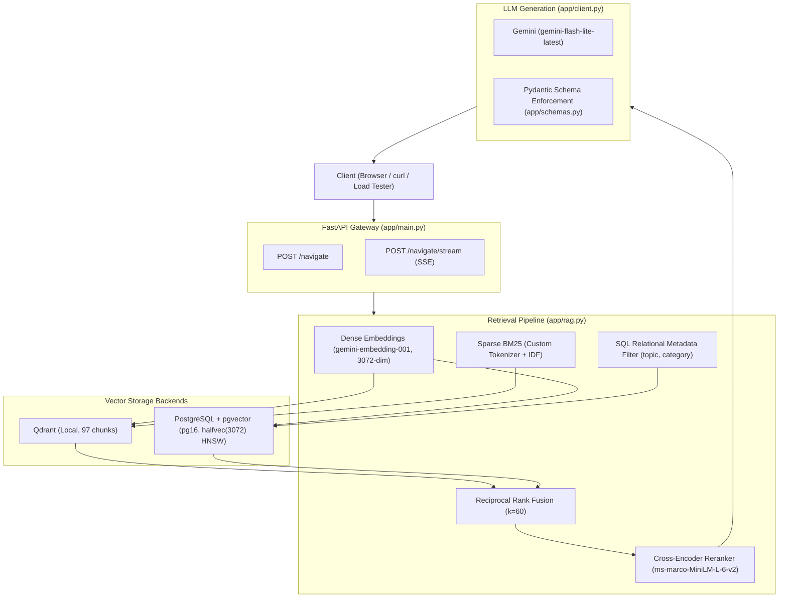

<div align="center">

# 🧭 Tutorial Hell Navigator

**A retrieval-augmented AI mentor for CS students stuck in tutorial hell.**

[](https://www.python.org/)
[](https://fastapi.tiangolo.com)
[](LICENSE)

[Architecture](#system-architecture) •
[Quickstart](#quickstart) •
[API Reference](#api-reference) •
[Evaluation](#evaluation-results) •
[Limitations](#known-limitations)

</div>

---

## The Problem

CS students and self-taught developers get trapped passively copying code from tutorials.
When faced with an empty editor, a broken build, or a database connection error, they freeze.

This tool retrieves relevant documentation chunks from a small technical corpus and generates
structured, step-by-step action plans with inline source citations. It attempts to refuse to answer
questions outside its corpus.

---

## System Architecture



**Corpus size:** 97 chunks (384-token target, 60 overlap, ~37k tokens total across 10 Tier-1 files). This fits entirely within
modern LLM context windows (see [Limitations](#known-limitations)).

---

## Features

### Structured Output
Returns machine-readable JSON via Pydantic schema enforcement: sequential steps with
commands, explanations, verification checks, and inline `chunk_id` citations.

### Dual Vector Storage Backends (Qdrant & PostgreSQL + pgvector)
Supports switching between two vector search engines:
- **Qdrant**: Local vector database with payload filtering and dual dense/sparse vector indexing.
- **PostgreSQL + pgvector**: Relational vector store using `pgvector/pgvector:pg16`.
  - **High-Dimension HNSW Indexing (`halfvec(3072)`):** Standard 32-bit `vector` in pgvector has a hard limit of 2,000 dimensions for HNSW indexes (`HNSW_MAX_DIM = 2000`). To support 3,072-dimensional embeddings (`gemini-embedding-001`), the engine utilizes 16-bit half-precision `halfvec(3072)` with `halfvec_cosine_ops`, enabling fast HNSW graph traversal without exceeding PostgreSQL indexing limits.
  - **SQL Metadata Filtering:** Relational metadata attributes (`topic`, `category`, `source_file`, `char_count`) can be filtered directly in SQL alongside vector distance (`<=>`) in a single query.
  - **In-Memory Simulation Fallback:** Automatic fallback to in-memory cosine search when running offline or in lightweight test environments.

### Hybrid Retrieval & Reciprocal Rank Fusion
Dual-index collection combining semantic embeddings with lexical BM25 matching.
Reciprocal Rank Fusion (RRF, $k=60$) merges both dense and sparse candidate sets. An optional cross-encoder (`ms-marco-MiniLM-L-6-v2`) reranks the top 10 candidates down to 3 for the LLM prompt.

### Uncalibrated Grounding & Refusal Gate
Every claim in the action plan must cite a verified `chunk_id`. To prevent high-frequency English stopwords (e.g., "how", "do", "I") from generating non-zero sparse scores on off-topic questions, raw BM25 hits are decoupled from grounding checks:
- **Uncalibrated confidence gate:** Queries must satisfy $(\text{dense\_score} \ge 0.40 \land \text{rerank\_score} \ge 0.50) \lor (\text{dense\_score} \ge 0.55)$ on Qdrant/hybrid-rerank, or a weaker rule of $\text{dense\_score} \ge 0.40$ alone on pgvector. None of these thresholds have been calibrated on a validation set.
- If ungrounded, context is injected with an out-of-bounds marker, triggering a structured refusal rather than hallucination.

### Concurrency Control
`asyncio.Semaphore(5)` caps concurrent outbound LLM requests to prevent 429 rate limit errors.

### Model Fallback Chain
On transient errors (503, 500), retries via `tenacity` exponential backoff (3 attempts,
2–10s). Falls back through candidate models if a tier is exhausted.

### Tool Calling
Three static tools: `search_error_catalog` (pattern-matched error fixes),
`get_project_milestones` (FastAPI, RAG, Fullstack, and DevOps roadmaps), `get_architecture_blueprint` (directory structures).

---

## Quickstart

### Prerequisites
- Python 3.10+
- A [Google Gemini API key](https://aistudio.google.com/)

### Setup
```bash
git clone https://github.com/k-nikhil-coder/tutorial-hell-navigator.git
cd tutorial-hell-navigator
python -m venv .venv
# Windows PowerShell:
.\.venv\Scripts\Activate.ps1
# macOS / Linux:
source .venv/bin/activate

pip install -r requirements.txt
cp .env.example .env
# Edit .env and add your GEMINI_API_KEY
```

### Index the Corpus
```bash
python app/ingestion.py
python app/rag.py
```

### Run the Server
```bash
uvicorn app.main:app --reload
```

---

## API Reference

### `POST /navigate`
Returns a structured JSON action plan. Supports specifying vector backend (`"qdrant"` or `"pgvector"`) and optional SQL metadata filters (`"topic"`, `"category"`).

```bash
curl -X POST http://localhost:8000/navigate \
  -H "Content-Type: application/json" \
  -d '{
    "query": "How do I set up CORS in FastAPI?",
    "backend": "pgvector",
    "topic": "FastAPI CORS & Security"
  }'
```

### `POST /navigate/stream`
Streams response tokens via Server-Sent Events. Supports `backend`, `topic`, and `category` fields.

### `GET /navigate/stream`
SSE streaming endpoint for browser event sources:
```bash
curl -N "http://localhost:8000/navigate/stream?query=Docker+psycopg2+build+failure&backend=pgvector&topic=Docker"
```

### `GET /health`
System health check returning model info, active tools, indexed chunk counts, and pgvector live connection status:
```json
{
  "status": "healthy",
  "model": "gemini-flash-lite-latest",
  "concurrency_limit": 5,
  "available_tools": ["search_error_catalog", "get_project_milestones", "get_architecture_blueprint"],
  "indexed_chunks": 97,
  "vector_store": "Qdrant",
  "pgvector_indexed_chunks": 97,
  "pgvector_is_live": false
}
```

### `GET /telemetry/trajectories?limit=10`
Returns logged query trajectories for analysis.

---

## Evaluation Results

Detailed historical progression, ablations, baseline comparisons, and failure audits are documented in [`docs/eval_log.md`](docs/eval_log.md). Below is the current measured state of the system:

### Current Benchmark Status (Day 45: 10-File Corpus, 97 Chunks)

| Metric | Target | Current Measured Result | Baseline / Comparison | 95% Confidence Interval / Notes |
| :--- | :---: | :---: | :---: | :--- |
| **Dev Split Hit@3 (v2 Overall)** | $\ge 80\%$ | **93.55%** (29/31) | 45.16% (14/31, 8-file index) | 95% Wilson CI: [79.28%, 98.21%] |
| ↳ *Official Docs (n=13)* | — | **84.62%** (11/13) | — | 95% Wilson CI: [57.77%, 95.67%] |
| ↳ *Owner-Authored Guides (n=18)* | — | **100.0%** (18/18) | — | 95% Wilson CI: [82.41%, 100.0%] |
| **Dev Split Evidence Coverage@3** | $\ge 80\%$ | **93.55%** (29/31) | 45.16% (14/31, 8-file index) | 29/31 required evidence items retrieved in top 3 |
| **Dev Split Hit@5** | — | **100.0%** (31/31) | 45.16% (14/31, 8-file index) | All 31 answerable questions retrieved within top 5 |
| **Dev Split MRR** | — | **0.8172** | 0.3763 (8-file index) | 95% Bootstrap CI: [0.7124, 0.9167] |
| **Out-of-Scope Refusal Rate** | $\ge 90\%$ | **88.9%** (8/9) | 88.9% (8/9) | 1 technical query (`GS-V2-50`) leaked past gate |
| **P50 Retrieval Latency** | $< 1,000\text{ ms}$ | **501.5 ms** | 505.7 ms | Hybrid-Rerank (Dense + BM25 + Cross-Encoder) |
| **Judge Blind Agreement (Day 45)** | $\ge 80\%$ | **46.67%** (14/30) | 84.0% (Day 44 first run) | ❌ **Failed gate:** $\kappa = -0.0667$; 95% CI: [30.2%, 63.9%] |

> [!IMPORTANT]
> **Resolution of the 45.2% Structural Index Ceiling (Day 45) & Necessary Caveats:**
> On Day 43, the initial benchmark v2 dev evaluation reported **45.16% Hit@3 (14/31)**, which I previously described as "the retriever got somewhere around half right." That characterization was incorrect: root-cause error analysis revealed the 45.16% score was an **indexing bug**. 17 of the 31 answerable questions referenced evidence from 3 source files (`fastapi_validation.md`, `docker_compose.md`, `postgresql_psycopg2.md`) that had been omitted from the initial 8-file index build. On what was indexed, the retriever had achieved 100% (14/14).
> On Day 45, I rebuilt the corpus from all 10 Tier-1 source files (97 chunks total, 384 tokens, 60 overlap). An automated test (`eval/check_span_coverage.py`) now asserts that every answerable gold span exists in at least one indexed chunk before evaluation runs (31/31 dev, 14/14 test). Evaluating the dev split on the complete 10-file corpus yielded **93.55% Hit@3 (29/31)** and **0.8172 MRR**.
> **Caveats on this score:**
> 1. *Source text near-copies:* Gold questions were formulated from the corpus text itself, so high recall on near-verbatim questions is expected.
> 2. *Author split imbalance:* The retriever scored 100% (18/18) on owner-authored guides but 84.6% (11/13) on official docs.
> 3. *Statistical sample size:* At n=31, one question is 3.2 percentage points, giving a wide 95% Wilson interval [79.3%, 98.2%]. Zero actual students have used the tool.
> 4. *Sealed test split:* The 25-question test split remains sealed and untouched.

> [!NOTE]
> **Heuristic Judge Diagnostic Breakdown Under Blind Evaluation (Day 45):**
> On Day 44, the judge scored 84.0% agreement ($\kappa = 0.6324$) on its first run over 50 synthetic pairs, and was subsequently overfitted to 100% via post-hoc rule tuning. To test genuine generalization on Day 45, I generated 30 fresh pairs using live model outputs (15 untouched outputs and 15 single-defect injected outputs spanning families the judge had no rules for), blinded the dataset, hand-graded all 30 pairs before execution, committed the hand grades (`a6645a2`), tagged the repo (`git tag judge-frozen-d45`), and ran the frozen judge once.
> Observed agreement dropped to **46.67% (14/30)** with $\kappa = -0.0667$ (worse than chance; 95% Wilson CI: [30.2%, 63.9%]). The diagnostic metrics explain the failure:
> - **Defect Recall: 66.7% (10 of 15 caught).** The judge caught 4/4 defects it had regex rules for (SQL injection, BaseSettings, CORS wildcard with credentials, hallucinated chunk IDs), but missed novel bugs like misspelled CLI flags (`--relod`), wrong default ports, and reversed Docker Compose port mapping syntax.
> - **Defect Precision: 47.6% (10 of 21 flagged were real defects).** Over half of the judge's FAIL verdicts were false alarms on clean model outputs.
> - **Clean Output Specificity: 26.7% (only 4 of 15 clean answers passed).** 11 clean outputs were falsely failed due to a **parser bug**: the command-prefix validator checked only single shell executables and rejected valid multi-line Python snippets (`from fastapi import...`) and Docker Compose YAML blocks (`healthcheck: ...`). It also penalized correct out-of-scope refusals.
> This demonstrates that the heuristic judge has a parser bug on multi-line code and only catches bugs the author explicitly anticipated. Full data in [`docs/eval_log.md`](docs/eval_log.md).

---

## Known Limitations

1. **Gold Benchmark v2 (Peer Contributors & Sealed Split).** The evaluation benchmark has been expanded from the tiny 23/30-question developer set to 65 questions labeled across 6 peer contributors (`contributor_1` through `contributor_6`) and project author Kumbham Nikhil. The dataset is split into a 40-question dev split and a sealed 25-question test split with question ID hash protection in `test_ids.sha256`.

2. **Full-context baseline is competitive (measured on the 8-file index with v1 labels).** The entire corpus (~37k tokens) fits in one LLM call. Full-corpus-in-context produces more ground-truth hits than the retrieval pipeline. The RAG stack is justified only by token cost savings at scale.

3. **Uncalibrated refusal gate.** The refusal gate uses a heuristic rule: `(dense_score >= 0.40 AND rerank_score >= 0.5) OR (dense_score >= 0.55)` for Qdrant/hybrid-rerank, and a weaker `dense_score >= 0.40` alone on pgvector. None of these thresholds have been calibrated on a validation set. While the gate catches 8 of 9 (88.9%) out-of-scope dev questions, adjacent topics can leak through: on the 10-file index, `GS-V2-50` (vLLM with Ray/tensor parallelism) leaked because re-indexed chunk `fastapi_fullstack_guide_sweep384_chunk_4` scored high enough to clear the threshold, whereas `GS-V2-48` (Feast feature store) was correctly refused.

4. **Offline Reviewer Agent Heuristics vs. Sandboxed Runtime.** The reviewer agent is an offline audit endpoint relying on static regexes, token overlap, and chunk ID verification. It does not execute commands in a sandboxed runtime. While post-hoc rule adjustments on Day 44 scored 100% on the 50 development pairs (first run: 84.0%, $\kappa = 0.6324$), running the frozen judge against 30 unseen live model outputs on Day 45 collapsed observed agreement to **46.7%** ($\kappa = -0.067$, 95% Wilson CI: [30.2%, 63.9%]). The collapse was driven by parser false alarms on multi-line Python/YAML commands (73.3% false alarm rate on clean outputs) and blindness to unmodeled bugs like CLI flag typos and port mistakes (40% miss rate on novel defect families). Adversarial prompts, multi-line snippets, and novel syntax variations easily break static heuristic filters.

5. **No real users.** Zero students have used this tool. The product thesis (that structured step-by-step plans help students escape tutorial hell) is untested.

6. **Non-reproducible outputs.** Using `-latest` model tags and a multi-model fallback chain means evaluation results vary across runs and API version changes.

7. **No rate limiting.** `asyncio.Semaphore(5)` limits concurrency, not request rate. There is no per-user or per-IP rate limit, no spend cap, and no authentication.

---

## Project Structure

```
tutorial-hell-navigator/
├── app/
│   ├── main.py            # FastAPI application and route handlers
│   ├── client.py          # Gemini API client with fallback chain & refusal gate
│   ├── reviewer.py        # AI Reviewer Agent (auditing hallucinated code & ungrounded steps)
│   ├── schemas.py         # Pydantic response models
│   ├── rag.py             # Retrieval: dense, BM25, RRF, hybrid
│   ├── pgvector_store.py  # PostgreSQL + pgvector storage & HNSW retrieval engine
│   ├── reranker.py        # Cross-encoder reranking (ms-marco-MiniLM-L-6-v2)
│   ├── ingestion.py       # PDF/Markdown parsing and token-aware chunking
│   ├── tools.py           # Static tool definitions (error catalog, milestones)
│   └── telemetry.py       # Query trajectory logging
├── corpus/
│   ├── raw/               # Source documents (Markdown, PDF)
│   └── processed/         # Chunked JSON files (384, 512, 1024 token variants)
├── data/
│   ├── bm25_vocab.json    # BM25 term frequencies and IDF
│   ├── embeddings_cache.json
│   └── qdrant_db/         # Local Qdrant storage
├── eval/
│   ├── judge.py                         # Heuristic evaluation judge & calibration engine
│   ├── judge_calibration_data.json      # 50 hand-graded pairs (faithfulness, citation validity, adherence)
│   ├── judge_calibration_report.json    # First-run calibration results (84.0% agreement, Cohen's kappa 0.6324)
│   ├── gold_benchmark_v2.json           # 65 questions across 6 peer contributors and author
│   ├── gold_benchmark_v2_dev_results.json # Dev split retrieval evaluation results
│   ├── split_v2.json                    # Dev (40) / test (25) split definitions
│   ├── test_ids.sha256                  # SHA256 question ID hash for held-out test split
│   ├── schema.py                        # Pydantic schema v2 with 5 strict validation rules
│   ├── gold_set.json                    # Legacy 88 questions, 30 with labeled chunk_ids
│   ├── pgvector_qdrant_comparison.json  # Qdrant vs pgvector comparative evaluation results
│   ├── run_eval.py                      # Evaluation harness (Recall@K, MRR, split protection)
│   └── *.json                           # Evaluation report artifacts
├── scripts/
│   ├── build_gold_benchmark_v2.py       # Benchmark generation and verbatim span validator
│   └── build_judge_calibration_data.py  # Day 44 calibration dataset builder
├── tests/                 # pytest suite (unit, RAG, pgvector, UI, reviewer, judge tests)
├── docs/
│   ├── eval_log.md        # Comprehensive evaluation log & experiment notebook
│   ├── scope.md           # Strict Tier 1 scope (FastAPI, Docker, Pydantic, Postgres)
│   ├── success_metric.md  # Product success definition
│   └── user_testing_guide.md # Script and protocol for observing real students
├── docker-compose.yml     # Multi-container orchestration (FastAPI + pgvector/pgvector:pg16)
├── Dockerfile
├── requirements.txt
└── README.md
```

---

## Running Tests

```bash
pytest tests/ -v
```

---

## Docker

```bash
docker-compose up --build
```

The `docker-compose.yml` orchestrates both the FastAPI backend and a persistent `pgvector/pgvector:pg16` database instance.

---

## License

MIT License. See [`LICENSE`](LICENSE).

---

<div align="center">
  <sub>Built by <a href="https://github.com/k-nikhil-coder">Kumbham Nikhil</a></sub>
</div>
