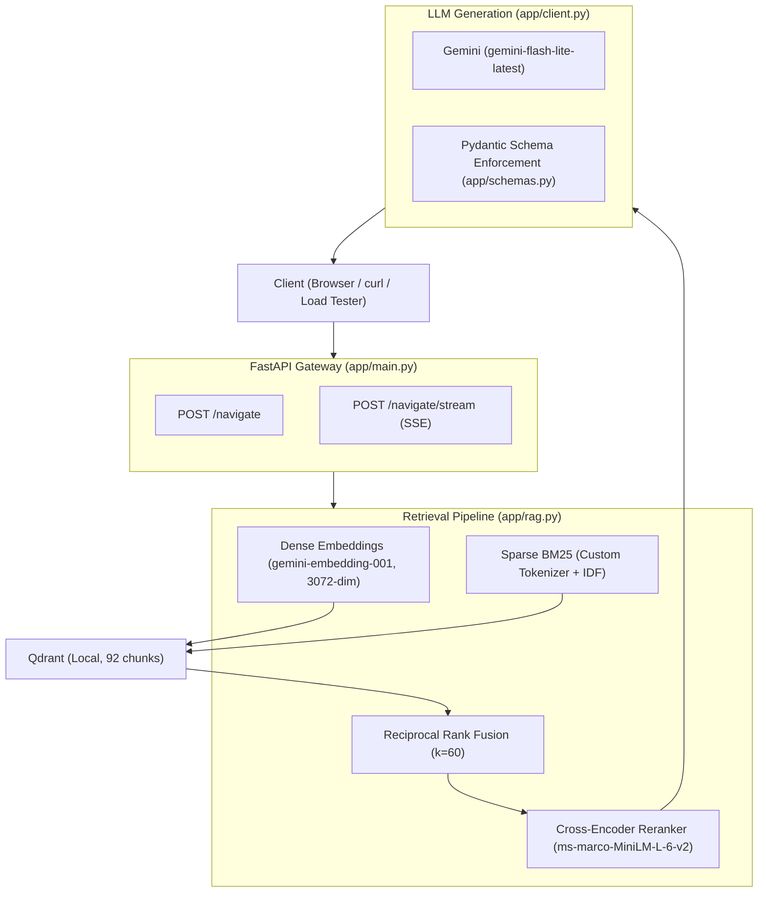

<div align="center">

# 🧭 Tutorial Hell Navigator

**A retrieval-augmented AI mentor for CS students stuck in tutorial hell.**

[](https://www.python.org/)
[](https://fastapi.tiangolo.com)
[](LICENSE)

[Architecture](#system-architecture) •
[Quickstart](#quickstart) •
[API Reference](#api-reference) •
[Evaluation](#evaluation-results) •
[Limitations](#known-limitations)

</div>

---

## The Problem

CS students and self-taught developers get trapped passively copying code from tutorials.
When faced with an empty editor, a broken build, or a database connection error, they freeze.

This tool retrieves relevant documentation chunks from a small technical corpus and generates
structured, step-by-step action plans with inline source citations. It refuses to answer
questions outside its corpus.

---

## System Architecture



**Corpus size:** 92 chunks (384 tokens each, ~35k tokens total). This fits entirely within
modern LLM context windows (see [Limitations](#known-limitations)).

---

## Features

### Structured Output
Returns machine-readable JSON via Pydantic schema enforcement: sequential steps with
commands, explanations, verification checks, and inline `chunk_id` citations.

### Hybrid Retrieval (Dense + BM25 + RRF)
Dual-index Qdrant collection combining semantic embeddings with lexical BM25 matching.
Reciprocal Rank Fusion merges both result sets. A cross-encoder (`ms-marco-MiniLM-L-6-v2`)
reranks the top 10 candidates down to 3 for the LLM prompt.

### Inline Citations & Grounding Refusal Gate
Every claim in the action plan must cite a verified `chunk_id`. When retrieved context is insufficient, ambiguous, or out-of-corpus, the system sets `is_refusal: true` with an explicit technical explanation.

To prevent high-frequency English stopwords (e.g., "how", "do", "I") from generating non-zero BM25 sparse scores on off-topic questions (e.g., "How do I bake sourdough bread?"), the grounding check decouples raw sparse vector hits and enforces a composite confidence gate:
$$\text{is\_grounded} = (\text{dense\_score} \ge 0.40 \land \text{rerank\_score} \ge 0.50) \lor (\text{dense\_score} \ge 0.55)$$
If this threshold is not met, the model context is injected with an out-of-bounds marker, triggering deterministic structured refusal rather than hallucination.

### Concurrency Control
`asyncio.Semaphore(5)` caps concurrent outbound LLM requests. This is a concurrency
limiter, not a rate limiter — it does not enforce requests-per-minute.

### Model Fallback Chain
On transient errors (503, 500), retries via `tenacity` exponential backoff (3 attempts,
2–10s). Falls back through candidate models if a tier is exhausted. Note: using `-latest`
model tags means outputs are not reproducible across API version changes.

### Tool Calling
Three static tools: `search_error_catalog` (pattern-matched error fixes),
`get_project_milestones` (roadmaps for FastAPI, Fullstack, and RAG architectures), `get_architecture_blueprint` (directory structures).

### Student Web UI & Unstick Telemetry
- **Single-Page Chat UI (`frontend/index.html`):** Minimalist web interface served directly via FastAPI (`GET /` or `GET /chat`) enabling students to ask roadblocks, view streaming token plans, and inspect cited source chunks.
- **Unstick Metrics (`POST /api/feedback`):** Captures real-user testing telemetry against our core Phase 0 success metric: *"Did this answer unstick the student without copy-paste dependence?"* Logs ratings, comments, and unstick rates to `logs/feedback.jsonl`.

---

## Quickstart

### Prerequisites
- Python 3.10+
- A [Google Gemini API key](https://aistudio.google.com/)

### Setup
```bash
git clone https://github.com/<YOUR-USERNAME>/tutorial-hell-navigator.git
cd tutorial-hell-navigator
python -m venv .venv
# Windows PowerShell:
.\.venv\Scripts\Activate.ps1
# macOS / Linux:
source .venv/bin/activate

pip install -r requirements.txt
cp .env.example .env
# Edit .env and add your GEMINI_API_KEY
```

### Index the Corpus
```bash
python app/ingestion.py
python app/rag.py
```

### Run the Server
```bash
uvicorn app.main:app --reload
```

---

## API Reference

### `POST /navigate`
Returns a structured JSON action plan.

```bash
curl -X POST http://localhost:8000/navigate \
  -H "Content-Type: application/json" \
  -d '{"query": "How do I set up CORS in FastAPI?"}'
```

### `POST /navigate/stream`
Streams response tokens via Server-Sent Events.

### `GET /health`
Health check endpoint.

### `GET /telemetry/trajectories?limit=10`
Returns logged query trajectories for analysis.

---

## Evaluation Results

### Metric Definitions

To ensure evaluation rigor and prevent metric drift, retrieval metrics are strictly defined:

- **Evidence Coverage@K**: The fraction of `required_evidence` items covered within top $K$ candidates. An item counts as covered if a retrieved chunk contains its verbatim span or one of its acceptable alternatives:
  $$\text{Evidence Coverage}@K = \frac{1}{|Q|} \sum_{q=1}^{|Q|} \frac{\sum_{i=1}^{M_q} \mathbb{I}(\text{item } i \text{ covered in top } K)}{M_q}$$
- **Hit@K**: Binary indicator of whether at least one required evidence item is covered in the top $K$ retrieved chunks:
  $$\text{Hit}@K = \frac{1}{|Q|} \sum_{q=1}^{|Q|} \mathbb{I}\left(\sum_{i=1}^{M_q} \mathbb{I}(\text{item } i \text{ covered in top } K) \ge 1\right)$$
- **Mean Reciprocal Rank (MRR)**: Evaluates ranking quality based on the rank of the first covered evidence item:
  $$\text{MRR} = \frac{1}{|Q|} \sum_{q=1}^{|Q|} \frac{1}{\text{rank of first covered item in } q}$$
  *(Rank 1 = 1.0, Rank 2 = 0.50, Rank 3 = 0.333, unretrieved = 0.0)*

*(Note: In historical v1 logs, "Recall@K" referred to Hit@K binary chunk matching. Under the v2 schema, both Evidence Coverage@K and Hit@K are tracked independently).*

### Retrieval Metrics (n=23 labeled questions)

All retrieval numbers below are measured on the 23 baseline questions in
[`eval/gold_set.json`](eval/gold_set.json) that have human-labeled `expected_chunk_ids`.
Each question is worth ~4.3 points of recall. No confidence intervals have been computed.
No held-out test split exists for this historical baseline — all tuning and reporting use the same 23 questions.

| Pipeline | Recall@3 (n=23) | Recall@5 (n=23) | MRR (n=23) |
| :--- | :---: | :---: | :---: |
| Dense-only (`gemini-embedding-001`) | 60.9% (14/23) | 78.3% (18/23) | 0.568 |
| Hybrid (Dense + BM25 + RRF) | 69.6% (16/23) | 78.3% (18/23) | 0.573 |
| Hybrid + Cross-Encoder Reranker | 65.2% (15/23) | 82.6% (19/23) | 0.578 |
| Hybrid + Reranker + 384-token chunks | 78.3% (18/23) | 78.3% (18/23) | 0.667 |

**Differences between pipelines:**
- Hybrid vs Dense-only: +8.7 points Recall@3 (+2 questions)
- 384-token sweep vs 512-token baseline: +13.0 points Recall@3 (+3 questions), but -4.3 points Recall@5 (-1 question)
- Reranker vs Hybrid: -4.3 points Recall@3 (-1 question), +4.3 points Recall@5 (+1 question)

At n=23, a single question changes any metric by ~4.3 points. These differences are not
statistically validated.

### Three-Way Baseline Comparison (n=30 questions with labels)

To test whether the retrieval pipeline outperforms simpler alternatives, three
configurations were benchmarked on 30 labeled questions using a pinned model
(`gemini-flash-lite-latest`, no fallback chain):

| Configuration | Avg Prompt Tokens | Valid Citations | Ground-Truth Hits | P50 Latency |
| :--- | :---: | :---: | :---: | :---: |
| Zero-retrieval (LLM weights only) | 277 | 0 | 0 | 3,140 ms |
| Full-corpus-in-context (~35k tokens) | 33,279 | 123 | 40 | 4,201 ms |
| Current pipeline (Hybrid + Reranker, K=3) | 1,833 | 64 | 29 | 3,031 ms |

Full-corpus-in-context achieves more ground-truth citation hits (40 vs 29) by giving the
LLM access to all 92 chunks. The retrieval pipeline's advantage is **18× fewer prompt
tokens** and ~1,170 ms lower P50 latency. At this corpus size, the retrieval stack is a
cost/latency optimization, not an accuracy improvement.

### Format Pass Rate

The "100% pass rate" reported in earlier versions measures format compliance (≥1 step, ≥1
command, ≥1 anti-pattern, no banned phrases). The Pydantic schema enforces most of these
constraints by construction. This metric does not measure whether the advice is correct or
whether cited chunks actually support the claims made.

No faithfulness or correctness evaluation has been performed.

---

## Known Limitations

1. **Tiny labeled set.** Retrieval metrics are computed on 23 (now 30) labeled questions.
   Each question shifts recall by ~3–4 points. No confidence intervals exist.
   All tuning and evaluation use the same questions (no dev/test split).

2. **Full-context baseline is competitive.** The entire corpus (~35k tokens) fits in one
   LLM call. Full-corpus-in-context produces more ground-truth hits than the retrieval
   pipeline. The RAG stack is justified only by token cost savings at scale.

3. **Refusal gate is broken.** The `dense >= 0.40 OR sparse > 0` gate lets through any
   query containing common English words. Off-topic queries rely on LLM self-refusal.

4. **No correctness evaluation.** "Pass rate" checks format, not whether advice is right
   or supported by the cited chunk. No faithfulness metric exists.

5. **No real users.** Zero students have used this tool. The product thesis (that
   structured step-by-step plans help students escape tutorial hell) is untested.

6. **Non-reproducible outputs.** Using `-latest` model tags and a multi-model fallback
   chain means evaluation results vary across runs and API version changes.

7. **No rate limiting.** `asyncio.Semaphore(5)` limits concurrency, not request rate.
   There is no per-user or per-IP rate limit, no spend cap, and no authentication.

---

## Project Structure

```
tutorial-hell-navigator/
├── app/
│   ├── main.py            # FastAPI application and route handlers
│   ├── client.py           # Gemini API client with fallback chain
│   ├── schemas.py          # Pydantic response models
│   ├── rag.py              # Retrieval: dense, BM25, RRF, hybrid
│   ├── reranker.py         # Cross-encoder reranking (ms-marco-MiniLM-L-6-v2)
│   ├── ingestion.py        # PDF/Markdown parsing and token-aware chunking
│   ├── tools.py            # Static tool definitions (error catalog, milestones)
│   └── telemetry.py        # Query trajectory logging
├── corpus/
│   ├── raw/                # Source documents (Markdown, PDF)
│   └── processed/          # Chunked JSON files (384, 512, 1024 token variants)
├── data/
│   ├── bm25_vocab.json     # BM25 term frequencies and IDF
│   ├── embeddings_cache.json
│   └── qdrant_db/          # Local Qdrant storage
├── eval/
│   ├── gold_set.json       # Benchmark questions (including 30 with ground-truth labels)
│   ├── bootstrap.py        # Paired bootstrap confidence intervals (1,000 resamples)
│   ├── run_eval.py         # Evaluation harness (Recall@K, MRR, latency, token costs)
│   ├── test_baselines.py   # Three-way baseline comparison script
│   └── *.json              # Evaluation report artifacts
├── frontend/
│   ├── index.html          # Lightweight SPA chat interface for real students
│   └── app.py              # Standalone frontend server bridge
├── docs/
│   ├── scope.md            # Strict Tier 1 scope (FastAPI, Docker, Pydantic, Postgres)
│   ├── success_metric.md   # Core unstick metric definition
│   └── user_testing_guide.md # Script and protocol for observing real students
├── tests/                  # Automated pytest suite (70+ unit, schema v2, and UI tests)
├── docker-compose.yml
├── Dockerfile
├── requirements.txt
└── README.md
```

---

## Running Tests

```bash
pytest tests/ -v
```

---

## Docker

```bash
docker-compose up --build
```

The `docker-compose.yml` mounts a persistent volume for Qdrant data.

---

## License

MIT License. See [`LICENSE`](LICENSE).

---

<div align="center">
  <sub>Built by <a href="https://github.com/k-nikhil-coder/">Kumbham Nikhil</a></sub>
</div>
