# Full Project Roadmap: Tutorial Hell Navigator

---

## 1. Product Vision & Success Metric

> **Product Vision:**  
> A student uses the tool to get unstuck, and the student then solves the next similar problem without the tool.

- **Primary Success Metric ([`docs/success_metric.md`](file:///c:/Users/kunbh/tutorial-hell-navigator-main/docs/success_metric.md)):**  
  *"Percent of students who complete a small task without help after they use the tool."*
- **Operational Targets:**  
  - $70\%$ unaided completion on follow-up tasks.
  - $60\%$ voluntary 7-day retention.

---

## 2. Current Execution Status

```mermaid
flowchart LR
    P0["Phase 0: Freeze & Success Metric<br/>✅ COMPLETED"] --> P1["Phase 1: Trustworthy Eval<br/>⏸️ ACTIVE (Gate C2 STOP)"]
    P1 --> P2["Phase 2: Quality & Refusal<br/>🔒 LOCKED"]
    P2 --> P3["Phase 3: Real User Testing<br/>🔒 LOCKED"]
    P3 --> P4["Phase 4: Hint Ladder & Thesis<br/>🔒 LOCKED"]
    P4 --> P5["Phase 5: Production Hardening<br/>🔒 LOCKED"]
    P5 --> P6["Phase 6: Multi-Student Pilot<br/>🔒 LOCKED"]
    P6 --> P7["Phase 7: Scale / Pivot / Stop<br/>🔒 LOCKED"]

    style P0 fill:#2e7d32,stroke:#1b5e20,color:#fff
    style P1 fill:#f57f17,stroke:#e65100,color:#fff
    style P2 fill:#424242,stroke:#212121,color:#ccc
    style P3 fill:#424242,stroke:#212121,color:#ccc
    style P4 fill:#424242,stroke:#212121,color:#ccc
    style P5 fill:#424242,stroke:#212121,color:#ccc
    style P6 fill:#424242,stroke:#212121,color:#ccc
    style P7 fill:#424242,stroke:#212121,color:#ccc
```

- **Phase 0:** Gate passed. Purged marketing claims, defined single-sentence success metric, and removed the abandoned query rewriter.
- **Phase 1 (Status Correction):** Stopped at **Gate C2** awaiting owner approval of [`docs/scope.md`](file:///c:/Users/kunbh/tutorial-hell-navigator-main/docs/scope.md).

---

## 3. Phase 1 Operational Execution Plan (Blocks A–G)

### Block A: Fix Invalid Work *(Completed)*
- [x] **A1:** Removed the token-overlap classifier from [`eval/error_analysis.py`](file:///c:/Users/kunbh/tutorial-hell-navigator-main/eval/error_analysis.py); wrote `"NEEDS HUMAN"` across all failure causes in [`eval/error_analysis.json`](file:///c:/Users/kunbh/tutorial-hell-navigator-main/eval/error_analysis.json).
- [x] **A2:** Generated [`eval/error_review_sheet.csv`](file:///c:/Users/kunbh/tutorial-hell-navigator-main/eval/error_review_sheet.csv) with full chunk texts and blank human grading columns.
- [x] **A3:** Created and executed [`eval/label_audit.py`](file:///c:/Users/kunbh/tutorial-hell-navigator-main/eval/label_audit.py) (saved to [`eval/label_audit.json`](file:///c:/Users/kunbh/tutorial-hell-navigator-main/eval/label_audit.json)).
- [x] **A4:** Conducted README mismatch audit in [`eval/readme_mismatch.md`](file:///c:/Users/kunbh/tutorial-hell-navigator-main/eval/readme_mismatch.md) without editing `README.md`.
- [x] **A5:** Marked the $30$ tuned and post-hoc labeled questions as `"BURNED"` in [`eval/gold_set.json`](file:///c:/Users/kunbh/tutorial-hell-navigator-main/eval/gold_set.json), moved them to `dev`, and voided the old test split in [`eval/split.json`](file:///c:/Users/kunbh/tutorial-hell-navigator-main/eval/split.json) (`test_count: 0`).
- [x] **A6:** Marked all legacy evaluation reports matching `eval/*_report.json` with `"status": "LEGACY: corpus v1"`.

### Block B: Fix Evaluation Tools *(Completed)*
- [x] **B1:** Added paired bootstrap on per-question differences ($1,000$ resamples, seed 42) in [`eval/bootstrap.py`](file:///c:/Users/kunbh/tutorial-hell-navigator-main/eval/bootstrap.py); prints `INCONCLUSIVE` if 95% CI width $> 30$ points.
- [x] **B2:** Suppressed Recall@K computation for `"none"` and `"full-context"` modes in [`eval/run_eval.py`](file:///c:/Users/kunbh/tutorial-hell-navigator-main/eval/run_eval.py) (evaluates correctness only).
- [x] **B3:** Added `mean_latency`, `time_to_first_token_p95`, and `mean_prompt_tokens` to evaluation reports.
- [x] **B4:** Backported label format fields to all $392$ questions in [`eval/gold_set.json`](file:///c:/Users/kunbh/tutorial-hell-navigator-main/eval/gold_set.json): `answer_spans`, `acceptable_alternatives`, and `span_status: "UNVERIFIED"`.
- [x] **B5:** Created [`scripts/spans_to_chunks.py`](file:///c:/Users/kunbh/tutorial-hell-navigator-main/scripts/spans_to_chunks.py) to dynamically map spans to chunk IDs for any arbitrary token size and overlap.
- [x] **B6:** Enforced `--final` flag on `test` split in [`eval/run_eval.py`](file:///c:/Users/kunbh/tutorial-hell-navigator-main/eval/run_eval.py), validated against [`eval/test_ids.sha256`](file:///c:/Users/kunbh/tutorial-hell-navigator-main/eval/test_ids.sha256), and added run logging to [`eval/final_runs.log`](file:///c:/Users/kunbh/tutorial-hell-navigator-main/eval/final_runs.log).
- [x] **B7:** Built blind grading sheet generator in [`scripts/make_grading_sheet.py`](file:///c:/Users/kunbh/tutorial-hell-navigator-main/scripts/make_grading_sheet.py) (shuffled outputs, hidden mode names, separate unblind key).
- [x] **B8:** Added unit tests in [`tests/test_block_b.py`](file:///c:/Users/kunbh/tutorial-hell-navigator-main/tests/test_block_b.py) (all $66$ tests pass in $21.95$s).

### Block C: Scope Specification *(Active)*
- [x] **C1:** Wrote [`docs/scope.md`](file:///c:/Users/kunbh/tutorial-hell-navigator-main/docs/scope.md):
  - Removed *Pro Git* due to non-permissive `CC BY-NC-SA 3.0` license.
  - Verified all documentation URLs live (`HTTP 200, 2026-11-02`).
  - Added explicit "Out of Scope" list (AI/ML, DSA, Competitive Programming, Career, Resume, Theory).
  - Classified all $13$ files in [`corpus/raw/`](file:///c:/Users/kunbh/tutorial-hell-navigator-main/corpus/raw/): $10$ IN Tier 1, $3$ OUT of Tier 1.
- [ ] **C2 (STOP):** **Awaiting owner approval of [`docs/scope.md`](file:///c:/Users/kunbh/tutorial-hell-navigator-main/docs/scope.md).**

### Block D: Corpus V2 *(Triggered by C2 Approval)*
- [ ] **D1:** Write `corpus/manifest.json` (topic, URL, license, license URL, version/date, fetch date, HTTP status).
- [ ] **D2:** Extend `scripts/fetch_docs.py` to fetch only manifest sources.
- [ ] **D3:** Chunk corpus with fixed $384$ tokens and $60$ overlap (no parameter tuning).
- [ ] **D4:** Rebuild dense index (Qdrant) and sparse index (BM25).
- [ ] **D5:** Write `eval/corpus_stats.md` (chunk counts per topic, total tokens, context window fit analysis).
- [ ] **D6 (STOP):** Wait for owner review of `corpus_stats.md`.

### Block E: Blind Question Collection
- [ ] **E1:** Enforce strict blind collection (no corpus files read during collection).
- [ ] **E2:** Run `scripts/collect_questions.py` across approved tags (last 12 months, seed 42, 75 per topic, $\le 30$ LOC, HTML stripped).
- [ ] **E3:** Add `eval/raw_questions.jsonl` to `.gitignore`; commit only IDs and URLs.
- [ ] **E4:** Generate `eval/answerability_sheet.csv` (`id, topic, text, owner_answerability, owner_notes`).
- [ ] **E5 (STOP):** Wait for owner to fill answerability sheet.

### Block F: Spans, Splits & Dev Evaluation
- [ ] **F1:** Propose up to 3 candidate spans for answerable questions in `eval/span_sheet.csv` (`span_status: "UNVERIFIED"`).
- [ ] **F2 (STOP):** Wait for owner to verify spans.
- [ ] **F3:** Generate `eval/refusal_set.json` (Part A: unanswerable/out-of-scope; Part B: 50 in-scope synthetic queries with typos/ambiguity).
- [ ] **F4:** Split questions stratified by topic (seed 42, 60% dev, 40% test; zero burned questions in test).
- [ ] **F5:** Draft `docs/decision_rule.md` from owner criteria.
- [ ] **F6:** Run the 4 modes (`none`, `vanilla`, `full-context`, `hybrid-rerank`) on DEV split only.
- [ ] **F7 (STOP):** Wait for owner blind grading and cost ceiling finalization.

### Block G: Final Decision Run
- [ ] **G1:** Execute test split once with `--final`.
- [ ] **G2:** Save report with execution timestamp, git commit, and SHA-256.
- [ ] **G3:** Apply `docs/decision_rule.md` to output verdict: **`KEEP`**, **`DELETE`**, or **`INCONCLUSIVE`**.
- [ ] **Phase 1 Gate:** If `full-context` matches `hybrid-rerank` on the test set, delete Qdrant, BM25, RRF, and the cross-encoder.

---

## 4. Complete Macro Roadmap (Phases 0–7)

| Phase | Timeline | Core Focus | Gate Requirement |
| :--- | :--- | :--- | :--- |
| **Phase 0: Freeze & Success Metric** | Days 1–3 | Stop component bloat; define retention & unaided completion metrics; clean README. | **Passed:** Single-sentence metric defined; targets set ($60\%$ retention, $70\%$ completion). |
| **Phase 1: Trustworthy Evaluation** | Week 1 | $\ge 150$ verified questions; dev/test split; 3 baselines (`none`, `full-context`, `vanilla`); paired bootstrap. | **Gate:** If `full-context` matches retrieval pipeline on test set, delete Qdrant, BM25, RRF, and reranker. |
| **Phase 2: Quality & Refusal** | Week 2 | Faithfulness & correctness checks; calibrated LLM judge against 50 hand-graded outputs; 100-query refusal gate. | **Gate:** $\ge 80\%$ judge agreement with human labels; calibrated refusal false-alarm/miss rates. |
| **Phase 3: Watch Real People** | Weeks 2–3 | 5 students live screen-share (30 min each) on real coding roadblocks; log benchmark gaps. | **Gate:** $\ge 3$ of 5 students voluntarily return within 7 days. |
| **Phase 4: Fix the Thesis** | Weeks 3–5 | Replace "command dump" with pedagogical scaffolding: attempt-first prompt, hint ladder, explain-why checkpoints. | **Gate:** Scaffolding mode beats command dump on unaided task completion in a 10-student trial. |
| **Phase 5: Production Hardening** | Weeks 5–6 | IP rate limiting, daily spend cap, auth/invite codes, managed Qdrant deployment, load testing ($n=100s$). | **Gate:** Safe for public deployment for 1 week without risk of unbounded billing or credential leakage. |
| **Phase 6: Student Pilot** | Weeks 7–9 | 20–30 students; weekly telemetry reviews; failure taxonomy analysis; automated CI regression gate. | **Gate:** Week-4 retention and unaided completion exceed Phase 0 targets ($60\%$ and $70\%$). |
| **Phase 7: Final Decision** | Week 10 | Evaluate pilot data to choose long-term trajectory. | **Decision:** **Scale** (metrics hold), **Pivot** (e.g. debugging coach / interview prep), or **Stop** (preserve as portfolio exhibit). |

---

## 5. Component Cut List & Deferred Scope

### Cut List (Executed or Scheduled for Deletion)
- **Query Rewriter:** Deleted from codebase (`app/rewriter.py` purged in `429ca14`).
- **Marketing Badges & Unbacked Claims:** Purged from `README.md`.
- **Reranker & Hybrid Stack:** Scheduled for deletion if Phase 1 Gate proves `full-context` matches performance on the test split.

### Deferred Work Table (Do Not Touch Until Gate Passes)

| Activity | Prerequisite Gate |
| :--- | :--- |
| **Web UI Polish** | Phase 3 Gate (real students validate demand) |
| **Multi-Model Fallback Tuning** | Phase 5 Gate (production hardening) |
| **New Corpus Documents** | Block C/D approval & error analysis identifying genuine corpus gaps |
| **Marketing or Public Launch** | Phase 6 Gate (pilot metrics validated) |